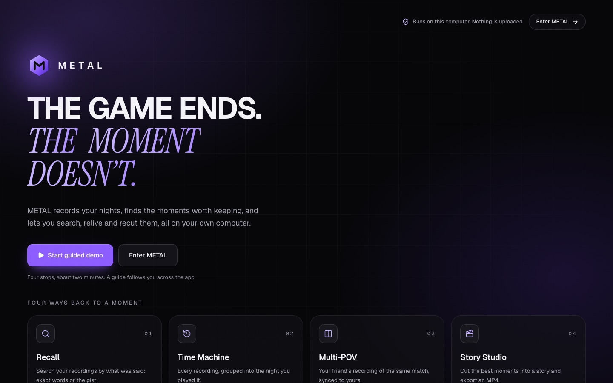

<p align="center">
  
</p>

<h1 align="center">METAL</h1>
<p align="center"><strong>Every moment has a story.</strong><br/>A local-first gaming memory platform that turns raw gameplay recordings into moments you can search, relive and recut.</p>

<p align="center">
  🥈 <strong>2nd place, HACKATHON_NAME</strong> ·
  <a href="DEMO_VIDEO_URL">Demo video</a> ·
  <a href="LIVE_DEMO_URL">Live demo (read-only)</a> ·
  Status: <strong>Experimental</strong>
</p>

> [!NOTE]
> METAL is an experimental, local-first gaming memory platform. AI-powered scene search is based on approximate visual similarity and may not identify every object, action, or event accurately.



## What it does

Every gamer has a folder of recordings they never open again. METAL runs on your own computer and turns that folder into memories. Nothing is uploaded.

| Feature | What it does |
|---|---|
| **Capture** | Controls OBS over obs-websocket: start and stop recording, run the replay buffer, save the last 30 s. Saved recordings import automatically. You can also import files or watch a folder. |
| **Smart Clip** | Measures each recording with FFmpeg (loudness, sudden jumps, picture changes) and suggests clips with the evidence shown, e.g. "Loudness rose 16.8 LU within a second". It doesn't claim to recognize kills or game events. |
| **Recall** | Searches what was said in your recordings, transcribed locally with whisper.cpp. Matches exact words or approximate meaning (SQLite FTS5 plus local MiniLM embeddings) and plays from the exact second. |
| **Visual Recall** *(experimental)* | Optional scene search: describe what was on screen ("dark hallway") and METAL compares your words with sampled frames using a local CLIP model. Results are labelled approximate. |
| **Game search and tags** | Find recordings by game or genre ("first-person shooter") from the game you set on a recording, plus a small set of hand-checked tags. Both are labelled as set by a person, never as AI detection. |
| **Time Machine** | Groups recordings into gaming nights by when they were actually recorded and lays the moments out on a timeline. **Relive** plays a night back, crossfading between recordings. |
| **Multi-POV** | Pairs your recording with a teammate's view of the same match. Sync is suggested from recording clocks and shared audio (spectral flux + FFT cross-correlation); you confirm it or nudge by frames. |
| **Story Studio** | Arrange, trim and caption clips, then export a real MP4 rendered locally with FFmpeg, including side-by-side POV clips and burned-in captions. |

<table>
  <tr>
    <td></td>
    <td></td>
  </tr>
  <tr>
    <td align="center"><sub>Recall: a spoken line, found by words and meaning</sub></td>
    <td align="center"><sub>Visual Recall (experimental): approximate scene match</sub></td>
  </tr>
  <tr>
    <td></td>
    <td></td>
  </tr>
  <tr>
    <td align="center"><sub>Time Machine: one night, in the order it happened</sub></td>
    <td align="center"><sub>Multi-POV: two players' views on one timeline</sub></td>
  </tr>
  <tr>
    <td></td>
    <td></td>
  </tr>
  <tr>
    <td align="center"><sub>Story Studio: side-by-side POVs, captioned, exported to MP4</sub></td>
    <td align="center"><sub>A hand-checked tag, labelled as tagged by a person</sub></td>
  </tr>
</table>

## About the AI: what it can and can't do

METAL ties every result to stored evidence: a timestamp, a transcript line, a measured signal or a frame. It says when it isn't sure.

- **Speech search** uses machine transcripts, which can contain mistakes. Lines you mark as wrong are removed from search.
- **Visual Recall is experimental.** It ranks frames by approximate CLIP similarity between your words and sampled frames (one every 2 s, plus scene cuts). It may miss things or return look-alike scenes, and it can't confirm actions such as kills, jumps or aces. Every visual match is labelled approximate. Details: [docs/visual-recall.md](docs/visual-recall.md).
- **Game and genre matches** come only from the game a person set on a recording, never from the video.
- **Hand-curated tags** (`data/recall-tags.json`) were checked by a person and are shown as "Tagged match · checked by hand". They're never presented as AI discoveries.
- **Smart Clip** reports loudness and picture changes, not events. Loud doesn't mean funny.

## Tech stack

- **App:** Next.js 16 (App Router, Cache Components), React 19, TypeScript, Tailwind CSS v4, Motion
- **Data:** SQLite via better-sqlite3 and Drizzle ORM, with FTS5 for keyword search and auto-applied migrations
- **Worker:** a separate Node.js process running a SQLite-backed job queue (import, transcode, analysis, transcription, visual indexing, POV matching, exports)
- **Media:** FFmpeg and ffprobe, always run with argument arrays, never through a shell
- **Local AI:** whisper.cpp (speech), `all-MiniLM-L6-v2` (sentence embeddings) and `clip-vit-base-patch16` (scene search) via transformers.js, with remote model loading disabled
- **Capture:** OBS Studio via obs-websocket
- **Tests:** Vitest (unit and route tests) plus Chrome DevTools Protocol browser checks

## Architecture

```
Browser UI (Next.js App Router, React 19)
   │  server components read SQLite · API routes queue work
   ▼
Next.js server (localhost) ──── SQLite (Drizzle, FTS5, jobs table) ──── data/media, data/exports
   ▲                                       ▲
   │ obs-websocket state/commands          │ claims jobs, heartbeats
   │                                       │
OBS ◄─────────────────────────── Worker process
                                  ├─ ingest / transcode   (FFmpeg, ffprobe)
                                  ├─ analyze              (loudness, scene change → Smart Clip rules)
                                  ├─ transcribe           (whisper.cpp + VAD → transcript, embeddings)
                                  ├─ visual-index         (frame sampling + local CLIP embeddings)
                                  ├─ pov-match            (spectral flux + FFT cross-correlation)
                                  ├─ clip-export          (exact range cut from the original)
                                  └─ story-export         (one FFmpeg pass, ffprobe-verified A/V length)
```

Design decisions are recorded as ADRs in [`docs/decisions/`](docs/decisions/).

## Run it locally

**Requirements:** macOS or Linux, Node.js 22+, FFmpeg and ffprobe on `PATH`. Optional: OBS Studio 30+ with obs-websocket (for capture) and whisper.cpp's `whisper-cli` (for transcription).

```bash
git clone https://github.com/alui712/metal.git
cd metal
npm ci
cp .env.example .env.local     # optional: tool paths and data location
npm run dev:all                # web app on http://localhost:3000 + background worker
```

The worker must be running for imports, analysis and exports to finish. All data stays in `data/` (git-ignored).

**Local models (optional, not included in this repository).** Speech and scene search need model files in `models/`:

| Feature | Files |
|---|---|
| Transcription | `models/ggml-base.en.bin` (and optionally `models/ggml-silero-v5.1.2.bin` for voice detection) from the whisper.cpp releases |
| Meaning search | `models/Xenova/all-MiniLM-L6-v2/` (`config.json`, `tokenizer.json`, `onnx/model_quantized.onnx`) |
| Visual Recall | `models/Xenova/clip-vit-base-patch16/` (configs, `tokenizer.json`, `onnx/text_model_quantized.onnx`, `onnx/vision_model_quantized.onnx`) |

`scripts/public-demo/fetch-models.sh` downloads the two transformers.js models from Hugging Face. Without them, METAL shows an honest "model not found" state and keyword search still works.

**Checks**

```bash
npm run typecheck && npm run lint && npm test && npm run build
```

## Online demo

The [live demo](LIVE_DEMO_URL) is a separate, read-only copy of METAL built from a handful of approved sample recordings that were already indexed. It is not connected to anyone's computer.

- Search (speech, meaning, game, tags and experimental scenes), video playback, Time Machine, Multi-POV and the guided tour all work.
- Recording, importing, editing and exports are refused on the server and shown as "runs on your own computer". No processing jobs run, and there is no worker.
- Set up with `METAL_PUBLIC_DEMO=1`. See [docs/deploy/public-demo.md](docs/deploy/public-demo.md).

## Project status

**Experimental.** METAL was built during a hackathon and placed 2nd. It is a working prototype, not a supported product. A desktop app, speaker labels and natural-language editing are future work.

METAL is an original project. It is not affiliated with or endorsed by Medal, OBS, Riot Games or any game publisher. Game names and footage belong to their respective owners.

## Team

Built by Alex Lui ([@alui712](https://github.com/alui712)), with Story Studio project management contributed by Hou Wai Yip.
